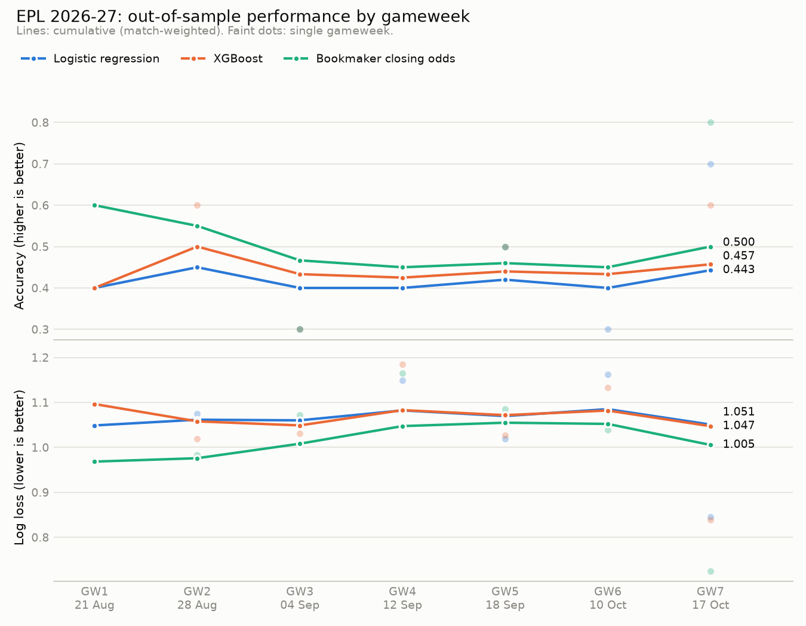

# EPL Match Outcome Predictor

[](https://github.com/rizwanbinaseef/PL-Model-26-27/actions/workflows/ci.yml)
[](https://github.com/rizwanbinaseef/PL-Model-26-27/actions/workflows/update.yml)

An end-to-end, automated machine-learning pipeline that predicts Premier League match
outcomes (home win / draw / away win). It retrains itself after every gameweek of the
2026-27 season and keeps a running, strictly out-of-sample record of how it performs.

> Portfolio project demonstrating data ingestion, leakage-free feature engineering,
> time-aware model evaluation and a scheduled retraining loop. **Not intended for betting.**



## Highlights

- **Automated pipeline**: a single command (`update_model.py`) pulls new results, scores the
  just-finished gameweek, retrains on all data and forecasts upcoming fixtures. It can run by hand or on a schedule.
- **No data leakage by construction**: every feature is computed from matches that kicked
  off *before* the match being predicted. Tests check this directly.
- **Honest evaluation**: time-based splits only; hyperparameters are tuned on a season the
  final validation never sees; live gameweeks are scored by a model trained only on earlier
  matches, using features frozen at the gameweek's first kickoff.
- **Benchmarked against the market**: models are compared with bookmaker closing odds, the
  toughest public benchmark in football forecasting.

## Results

### Validation season (2025-26, 380 matches)

Trained on 2019-20 → 2024-25. Hyperparameters were chosen on 2024-25 using an inner split, then
the model was refit on all training seasons. Validation data was never used for model selection.

| Model | Accuracy | Log loss ↓ | RPS ↓ |
|---|---:|---:|---:|
| Baseline: always predict home win | 42.6% | 1.085 | 0.228 |
| Logistic regression | 47.9% | **1.033** | **0.210** |
| XGBoost | 49.0% | 1.041 | 0.212 |
| Bookmaker closing odds (market average) | 49.5% | 1.012 | 0.205 |

*The always-home baseline's log loss and RPS use the training-set outcome frequencies as its
probabilities. RPS is the ranked probability score, the standard scoring rule for ordered football
outcomes.*

**Takeaways**

- Both models beat the naive baseline by ~5-6 accuracy points and clearly on log loss.
- Logistic regression is better calibrated (lower log loss) than XGBoost despite slightly lower
  accuracy. With ~2,300 training matches and mostly monotonic features, the extra capacity of trees
  mainly adds variance.
- The bookmaker's closing line remains best. Closing odds include information this model doesn't see
  (injuries, line-ups, team news), so getting within ~0.02 log loss is a reasonable result for a
  model built only on results data.
- No model, including the bookmaker, ever makes "draw" its top pick. Draws (27% of matches) are
  almost never the single most likely outcome, which caps accuracy near 50% and is why
  probabilistic metrics (log loss, RPS) matter more than accuracy here.

### Live 2026-27 season

`data/tracking.csv` holds a row per gameweek per model, appended automatically after each
completed gameweek. The chart above is regenerated from it. Over October and November 2026 this
becomes the season-long record (see `reports/tracking_oct_nov_2026.png`).

A gameweek has only ~10 matches, so a single gameweek's accuracy has a standard error of roughly
±15 points. The **cumulative** lines are the meaningful signal. The faint per-gameweek dots are
shown to make the noise visible.

## Methodology

### Data
[football-data.co.uk](https://www.football-data.co.uk/englandm.php) Premier League CSVs
(`E0.csv`) for 2019-20 through 2026-27, plus its `fixtures.csv` for upcoming matches. Columns used:
date/time, teams, full-time score and market-average closing odds (`AvgCH/AvgCD/AvgCA`). Average
odds were chosen over Pinnacle because Pinnacle closing odds are absent from the 2026-27 file.

### Features (19, all computed pre-match)
| Group | Features |
|---|---|
| Elo | home/away rating, rating difference, Elo expected score for the home side |
| Form (last 5, all venues) | points, goals for, goals against per game, for each team |
| Venue split (last 5) | home team's last 5 **home** games; away team's last 5 **away** games |
| Rest | days since each team's previous league match (capped at 21), and the difference |

**Elo details:** start 1500, K = 20, +60 home advantage, goal-margin multiplier `ln(|gd|+1)+1`,
ratings regressed 20% toward 1500 between seasons, promoted teams enter at 1400. Elo's expected
scores are well calibrated on the data (e.g. 0.38 predicted vs 0.40 actual in the 0.30-0.45 bin).

**Leakage prevention:** matches are processed in kickoff order. For each match the feature row is
read from the current team state *first*, and the state is updated with the result *afterwards*.
Unplayed fixtures get features but never update state.

### Models
- **Logistic regression**: median imputation (with missing-value indicators for promoted teams with
  no top-flight history) → standardisation → multinomial LR, tuned regularisation strength `C`.
- **XGBoost**: `multi:softprob`, shallow trees (grid over depth, number of trees, learning rate),
  native missing-value handling.

### Weekly update loop (`update_model.py`)
1. Download the latest 2026-27 results and upcoming fixtures.
2. Rebuild features from scratch (fast: ~2,700 matches).
3. Group the season into gameweeks. football-data has no gameweek column, so matches are grouped
   into the EPL's scheduling slots (Fri-Mon weekend, Tue-Thu midweek), and slots with fewer than 5
   matches (rearranged fixtures) are merged forward.
4. For each newly **completed** gameweek not yet logged: train on all matches before its first
   kickoff, predict it with its own results hidden, and append accuracy / log loss / RPS for both
   models and the bookmaker to `data/tracking.csv` (match-level predictions go to `data/predictions.csv`).
5. Retrain both models on all completed matches (`models/*_latest.joblib`) and write probabilities for
   upcoming fixtures to `data/upcoming_predictions.csv`.

The script is idempotent: re-running it without new results changes nothing.

## Quick start

```bash
python -m venv .venv
source .venv/bin/activate          # Windows: .venv\Scripts\activate
pip install -r requirements.txt

python -m src.ingest               # download all seasons
python -m src.train                # train + evaluate on 2025-26 -> models/evaluation.json
python update_model.py             # score new gameweeks, retrain, predict upcoming fixtures
python plot_tracking.py            # Oct-Nov 2026 chart (use --all for the whole season)
pytest                             # run the test suite
```

Useful flags: `update_model.py --as-of 2026-10-06` (pretend today is a given date) and
`--no-download` (work offline from `data/raw`).

### Scheduling
In this repo the update runs automatically via GitHub Actions ([`.github/workflows/update.yml`](.github/workflows/update.yml)) every Monday and Thursday at 09:00 UTC: it downloads new results, runs the tests, scores and logs completed gameweeks, retrains, regenerates the charts and commits the results. It can also be triggered manually from the Actions tab.

To run it on your own machine instead:

**cron (Linux/macOS)**
```
0 9 * * 1,4  cd /path/to/epl-predictor && .venv/bin/python update_model.py >> update.log 2>&1 && .venv/bin/python plot_tracking.py
```

**Windows Task Scheduler**
```
schtasks /create /tn "EPL model update" /sc weekly /d MON,THU /st 09:00 /tr "cmd /c cd /d C:\path\to\epl-predictor && .venv\Scripts\python update_model.py >> update.log 2>&1"
```

## Project structure

```
├── data/
│   ├── raw/                  downloaded CSVs (git-ignored, re-creatable)
│   ├── processed/            feature table (git-ignored)
│   ├── tracking.csv          per-gameweek live performance log
│   ├── predictions.csv       match-level live predictions
│   └── upcoming_predictions.csv
├── models/                   trained models (*.joblib, git-ignored) + evaluation.json
├── notebooks/
├── reports/                  generated charts
├── src/
│   ├── ingest.py             download + load football-data.co.uk CSVs
│   ├── features.py           Elo, form, venue splits, rest days (leakage-free)
│   ├── gameweeks.py          group fixtures into gameweeks
│   ├── models.py             model definitions, baselines, metrics
│   └── train.py              tuning, training, validation vs baselines
├── tests/                    leakage + correctness tests
├── update_model.py           weekly retrain / tracking job
└── plot_tracking.py          tracking chart
```

## Testing

`pytest` runs the checks on feature engineering and the update loop, including:
- **prefix invariance**: features for the first *n* matches are identical whether or not later matches exist;
- **perturbation**: changing a match's result leaves that match's and all earlier matches' features unchanged;
- **hidden future**: blanking all results after a cutoff doesn't change any feature before it;
- **update loop**: the model scoring a gameweek never sees a match from that gameweek or later, and
  the gameweek's features equal those computed from data ending before its first kickoff;
- hand-checked Elo updates, rolling windows, rest days, season regression and gameweek grouping.

## Limitations & next steps

- Only league results are used: no xG, line-ups, injuries or cup/European fixtures (so rest days
  ignore midweek European games).
- Promoted teams have no top-flight history; their form features are imputed.
- Possible extensions: expected-goals features, Dixon-Coles / Poisson goal models, probability
  calibration (isotonic / temperature scaling), recency-weighted training, and draw-aware decision rules.

## Data & licence
Match data © [football-data.co.uk](https://www.football-data.co.uk/), used for non-commercial,
educational purposes.
